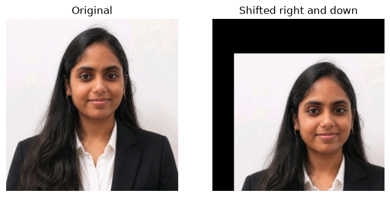
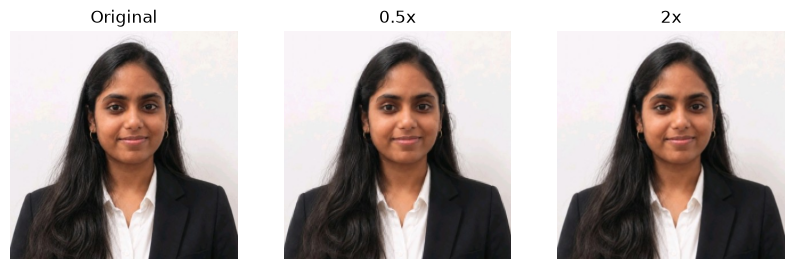
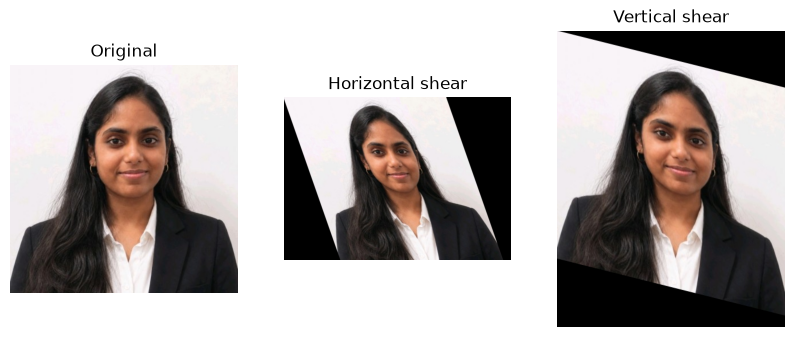
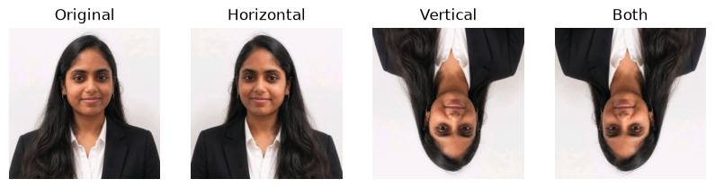
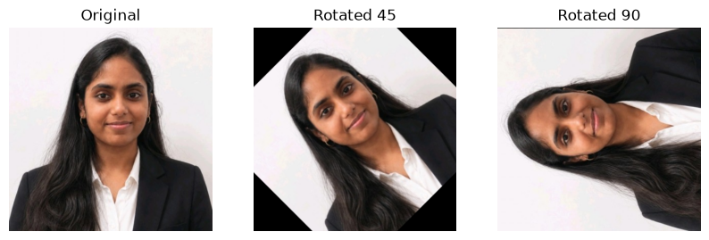

# EXP-4: Geometric Transformations Using OpenCV

## Experiment Details

- **Name:** Ramitha Chowdary S
- **Register Number:** 212224240130

## Aim

Move, resize, lean, flip and rotate a photo with OpenCV.

## Software Required

- Anaconda
- Python 3
- Jupyter Notebook
- OpenCV
- NumPy
- Matplotlib

## Algorithm

**Step 1:** Read ramitha.png and convert it to RGB.

**Step 2:** Shift it 50 pixels to the right and 80 pixels down with warpAffine.

**Step 3:** Resize it to 0.5x and to 2x.

**Step 4:** Shear it sideways and downwards.

**Step 5:** Flip it left-right, up-down, and both ways.

**Step 6:** Rotate it by 45 degrees and by 90 degrees around the centre.

## Program

#### 1. Read the photo

```python
import cv2
import numpy as np
import matplotlib.pyplot as plt

bgr = cv2.imread("ramitha.png")
img = cv2.cvtColor(bgr, cv2.COLOR_BGR2RGB)
rows, cols = img.shape[:2]
```

#### 2. Shift the photo

```python
move = np.float32([[1, 0, 50], [0, 1, 80]])
shifted = cv2.warpAffine(img, move, (cols, rows))
plt.figure(figsize=(8, 4))
plt.subplot(1, 2, 1)
plt.imshow(img)
plt.title("Original")
plt.axis("off")
plt.subplot(1, 2, 2)
plt.imshow(shifted)
plt.title("Shifted right and down")
plt.axis("off")
plt.show()
```

#### 3. Scale the photo

```python
small = cv2.resize(img, None, fx=0.5, fy=0.5)
big = cv2.resize(img, None, fx=2, fy=2)
plt.figure(figsize=(10, 4))
plt.subplot(1, 3, 1)
plt.imshow(img)
plt.title("Original")
plt.axis("off")
plt.subplot(1, 3, 2)
plt.imshow(small)
plt.title("0.5x")
plt.axis("off")
plt.subplot(1, 3, 3)
plt.imshow(big)
plt.title("2x")
plt.axis("off")
plt.show()
```

#### 4. Shear the photo

```python
shear_x = np.float32([[1, 0.35, 0], [0, 1, 0]])
shear_y = np.float32([[1, 0, 0], [0.25, 1, 0]])
lean_x = cv2.warpAffine(img, shear_x, (int(cols * 1.4), rows))
lean_y = cv2.warpAffine(img, shear_y, (cols, int(rows * 1.3)))
plt.figure(figsize=(10, 4))
plt.subplot(1, 3, 1)
plt.imshow(img)
plt.title("Original")
plt.axis("off")
plt.subplot(1, 3, 2)
plt.imshow(lean_x)
plt.title("Horizontal shear")
plt.axis("off")
plt.subplot(1, 3, 3)
plt.imshow(lean_y)
plt.title("Vertical shear")
plt.axis("off")
plt.show()
```

#### 5. Flip the photo

```python
plt.figure(figsize=(10, 3))
titles = ["Original", "Horizontal", "Vertical", "Both"]
pics = [img, cv2.flip(img, 1), cv2.flip(img, 0), cv2.flip(img, -1)]
for i in range(4):
    plt.subplot(1, 4, i + 1)
    plt.imshow(pics[i])
    plt.title(titles[i])
    plt.axis("off")
plt.show()
```

#### 6. Rotate the photo

```python
centre = (cols / 2, rows / 2)
rot45 = cv2.warpAffine(img, cv2.getRotationMatrix2D(centre, 45, 1), (cols, rows))
rot90 = cv2.warpAffine(img, cv2.getRotationMatrix2D(centre, 90, 1), (cols, rows))
plt.figure(figsize=(10, 4))
plt.subplot(1, 3, 1)
plt.imshow(img)
plt.title("Original")
plt.axis("off")
plt.subplot(1, 3, 2)
plt.imshow(rot45)
plt.title("Rotated 45")
plt.axis("off")
plt.subplot(1, 3, 3)
plt.imshow(rot90)
plt.title("Rotated 90")
plt.axis("off")
plt.show()
```

## Output

### i) Translation



### ii) Scaling



### iii) Shear



### iv) Flip



### v) Rotation



## Result

The photo was shifted, resized, sheared, flipped and rotated.
