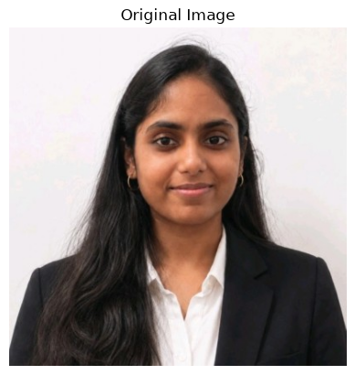
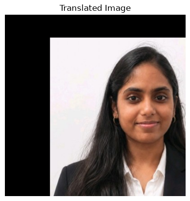
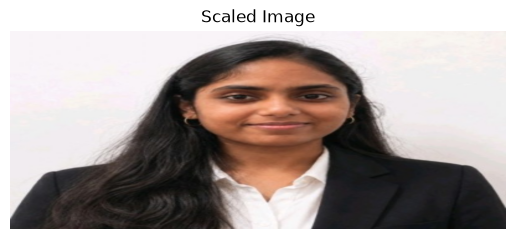
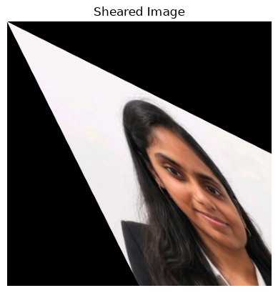
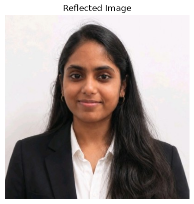
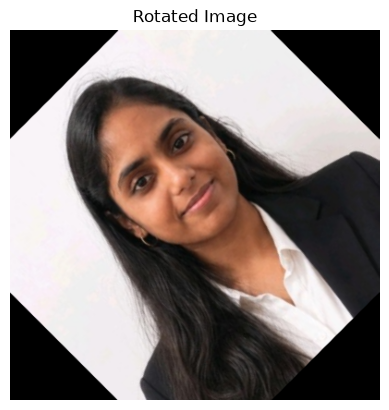
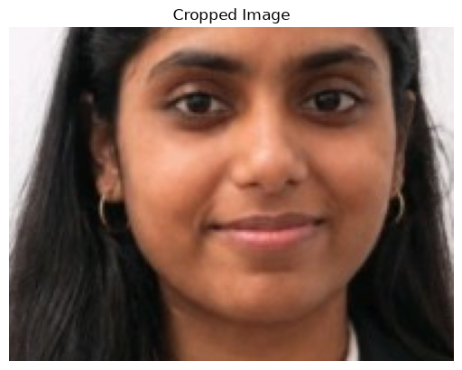

# EXP-4: Geometric Transformations Using OpenCV

## Experiment Details

- **Name:** Ramitha Chowdary S
- **Register Number:** 212224240130

## Aim

Move, resize, lean, flip and rotate a photo with OpenCV.

## Software Required

- Anaconda
- Python 3
- Jupyter Notebook
- OpenCV
- NumPy
- Matplotlib

## Algorithm

**Step 1:** Read ramitha.png and convert it to RGB.

**Step 2:** Shift it 50 pixels to the right and 80 pixels down with warpAffine.

**Step 3:** Resize it to 0.5x and to 2x.

**Step 4:** Shear it sideways and downwards.

**Step 5:** Flip it left-right, up-down, and both ways.

**Step 6:** Rotate it by 45 degrees and by 90 degrees around the centre.

## Program

#### 1.

```python
import cv2
import numpy as np
import matplotlib.pyplot as plt
```

#### 2.

```python
image = cv2.imread('ramitha.png')
```

#### 3.

```python
plt.imshow(cv2.cvtColor(image, cv2.COLOR_BGR2RGB))
plt.title("Original Image")
plt.axis('off')
```

#### 4.

```python
tx, ty = 100, 50
M_translation = np.float32([[1, 0, tx], [0, 1, ty]])
translated_image = cv2.warpAffine(image, M_translation, (image.shape[1], image.shape[0]))
```

#### 5.

```python
plt.imshow(cv2.cvtColor(translated_image, cv2.COLOR_BGR2RGB))
plt.title("Translated Image")
plt.axis('off')
```

#### 6.

```python
fx, fy = 5.0, 2.0
scaled_image = cv2.resize(image, None, fx=fx, fy=fy, interpolation=cv2.INTER_LINEAR)
```

#### 7.

```python
plt.imshow(cv2.cvtColor(scaled_image, cv2.COLOR_BGR2RGB))
plt.title("Scaled Image")
plt.axis('off')
```

#### 8.

```python
shear_matrix = np.float32([[1, 0.5, 0], [0.5, 1, 0]])
sheared_image = cv2.warpAffine(image, shear_matrix, (image.shape[1], image.shape[0]))
```

#### 9.

```python
plt.imshow(cv2.cvtColor(sheared_image, cv2.COLOR_BGR2RGB))
plt.title("Sheared Image")
plt.axis('off')
```

#### 10.

```python
reflected_image = cv2.flip(image, 2)
```

#### 11.

```python
plt.imshow(cv2.cvtColor(reflected_image, cv2.COLOR_BGR2RGB))
plt.title("Reflected Image")
plt.axis('off')
```

#### 12.

```python
(height, width) = image.shape[:2]
angle = 45
center = (width // 2, height // 2)
M_rotation = cv2.getRotationMatrix2D(center, angle, 1)
rotated_image = cv2.warpAffine(image, M_rotation, (width, height))
```

#### 13.

```python
plt.imshow(cv2.cvtColor(rotated_image, cv2.COLOR_BGR2RGB))
plt.title("Rotated Image")
plt.axis('off')
```

#### 14.

```python
x, y, w, h = 100, 100, 200, 150
cropped_image = image[y:y+h, x:x+w]
```

#### 15.

```python
plt.imshow(cv2.cvtColor(cropped_image, cv2.COLOR_BGR2RGB))
plt.title("Cropped Image")
plt.axis('off')
```

## Output















## Result

The photo was shifted, resized, sheared, flipped and rotated.
